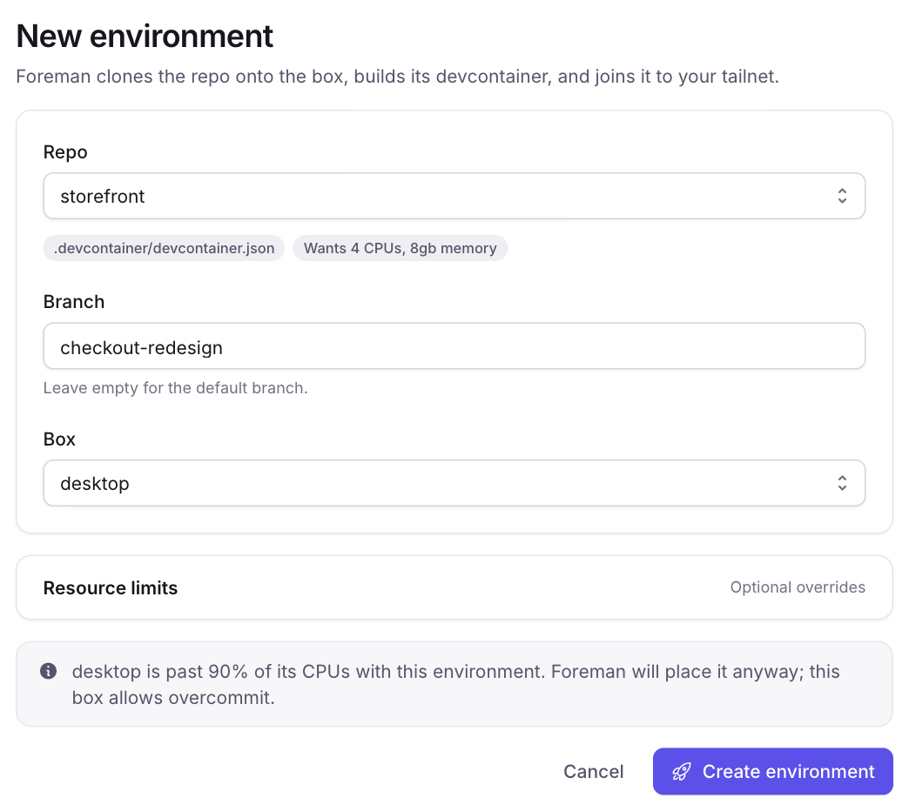
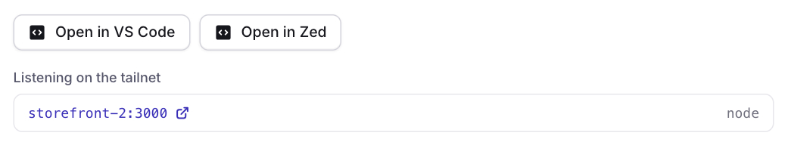
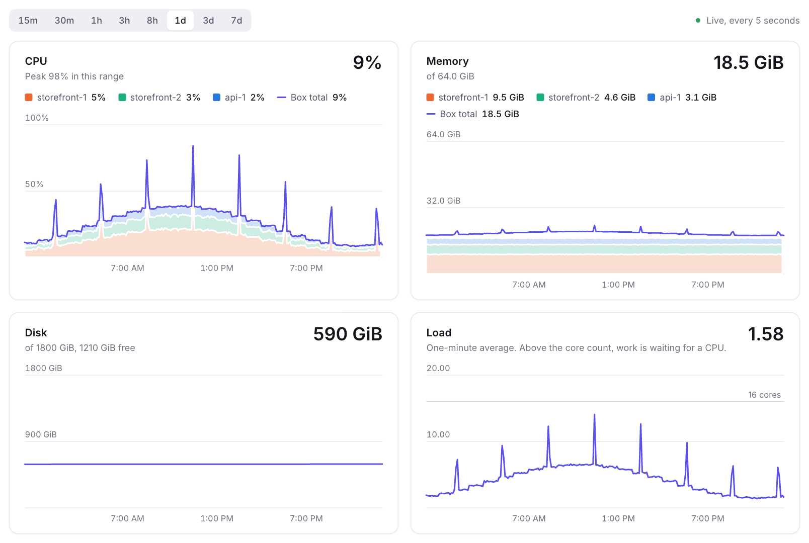
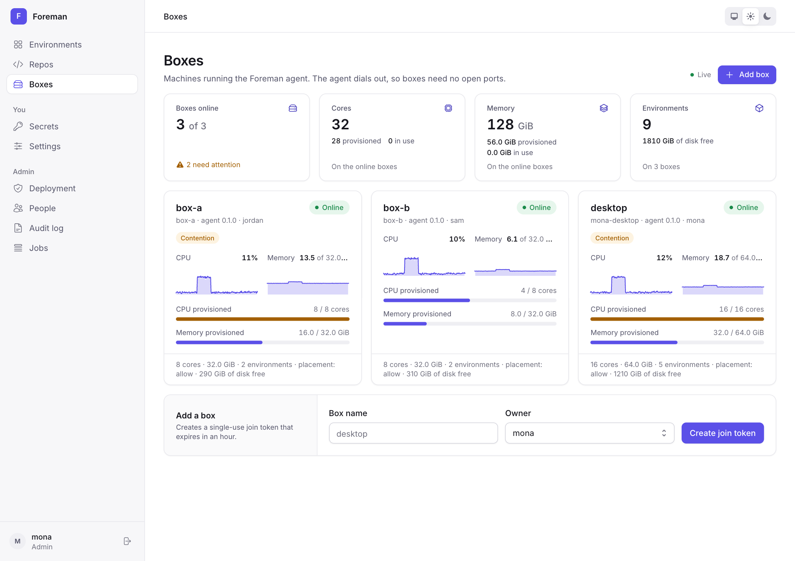

# Foreman

Foreman is a self-hosted alternative to GitHub Codespaces. Pick a repo,
branch, and machine in the dashboard. Foreman builds the devcontainer on
your hardware. From a laptop on the same tailnet, SSH in or open the
workspace in VS Code or Zed.

You can keep `main` running while you work on a feature branch. Each copy
gets its own VM, clone, Docker volumes, and tailnet hostname. Both copies
can run their app on port 3000. [Get started](#get-started)

<picture>
  <source media="(prefers-color-scheme: dark)" srcset="docs/images/environments-dark.png">
  
</picture>

## Get started

| Where you want to run Foreman | Start here |
| --- | --- |
| On one Linux desktop | Run the control plane and the environment host (the **box**) on the same machine with SQLite. [Personal setup](docs/setup/personal.md) |
| On a team’s hardware | Run a shared control plane with Postgres and enroll boxes for individual developers or share them with teammates. [Team setup](docs/setup/team.md) |

A box needs x86-64 Linux, KVM, systemd, and a kernel with Landlock enabled
(6.2 or newer). A box running inside a VM also needs nested virtualization.
The box agent connects out to the control plane. Each environment runs Docker
and Compose inside its own Cloud Hypervisor VM. The personal setup also runs
Docker on the host for the control plane.
[Flatcar box setup](docs/setup/flatcar.md) · [Architecture](docs/architecture.md)

To try the dashboard locally, run the demo from a checkout with mise installed.
It uses sample data and stand-in agents, so you can explore the UI without
setting up GitHub, Tailscale, or a VM host. [Install mise](https://mise.jdx.dev/)

```sh
mise install
cd apps/foreman
mix deps.get
mix assets.setup
PORT=4100 mix run --no-start ../../e2e/demo.exs
```

Open `http://localhost:4100/dev/sign-in/mona` to sign in to the demo.

## From a repo to a running app

1. **Choose a repo.** Install the GitHub App on the repos you want Foreman to
   see, then use **Repos → Sync from GitHub**. The repo needs a Compose-based
   `devcontainer.json` with `dockerComposeFile` and `service`. Foreman adds
   its Tailscale and credential helpers when it builds the environment.
   [GitHub App setup](docs/setup/github-app.md) · [Preparing a repo](docs/setup/repos.md)
2. **Create an environment.** Select **New environment**, choose the branch
   and box, and click **Create environment**. Leave the branch blank to use
   the repo’s default. Follow the build in **Activity** on the environment page.

<picture>
  <source media="(prefers-color-scheme: dark)" srcset="docs/images/new-environment-dark.png">
  
</picture>

3. **Connect from your laptop.** Once the environment is running, copy its SSH
   command or open it in VS Code or Zed. Bind your dev server to `0.0.0.0`
   inside the devcontainer. Its listening port appears under **Connect**.
   In this example, `ssh vscode@storefront-2` opens a shell and
   `http://storefront-2:3000` opens the app. [Tailscale setup](docs/setup/tailscale.md)

<picture>
  <source media="(prefers-color-scheme: dark)" srcset="docs/images/environment-dark.png">
  
</picture>

## Working with environments

Foreman gives each environment a GitHub token scoped to its repo by default.
Your git identity and dotfiles follow you into new environments, with per-repo
overrides in your settings.

| When you want to… | What to do |
| --- | --- |
| Free up the box | **Stop** shuts down the VM and keeps the clone and volumes. **Actions → Suspend** also saves memory to disk so **Start** can resume running processes. |
| Pick up devcontainer changes | **Rebuild** recreates containers and keeps the workspace and named volumes. **Pull and rebuild** checks for uncommitted or unpushed work before fast-forwarding the branch and rebuilding. |
| Speed up repeated builds | An admin can build a **prebuild** on the repo page. New environments on that box and default branch can reuse the cached images. [How prebuilds work](docs/architecture.md#prebuilds) |
| Change a secret | Set it for the owner, repo, user, or environment, in increasing order of precedence. Values are encrypted at rest. New login shells pick up a change immediately. **Restart affected** applies it to the services that use it. |
| Give a VM more memory or CPU | Open **Resources → Edit**, save the limits, then **Stop** and **Start**. The box page shows actual usage alongside provisioned capacity. |

Open a box to see which environments account for its CPU and memory use. Here’s one day on the desktop that hosts the two storefront branches.

<picture>
  <source media="(prefers-color-scheme: dark)" srcset="docs/images/box-dark.png">
  
</picture>

<details>
<summary>Box inventory and personal secrets</summary>

The Boxes page compares live usage with the resources allocated on each machine.

<picture>
  <source media="(prefers-color-scheme: dark)" srcset="docs/images/boxes-dark.png">
  
</picture>

Under **Secrets**, you can replace a personal secret or limit it to selected repos. The page shows the names and scopes. Values are write-only.

<picture>
  <source media="(prefers-color-scheme: dark)" srcset="docs/images/secrets-dark.png">
  
</picture>

</details>

## Operator and contributor guides

- [Security model and box trust](docs/security.md)
- [Private GHCR images and features](docs/setup/ghcr-machine-user.md)
- [Images on issues and pull requests with gh --attach](docs/setup/attachments.md)
- [Personal CLI connections and service accounts](docs/setup/api-clients.md)
- [Pairing tools through connect hooks](docs/setup/connect-hooks.md)
- [Upgrades, backups, and rollback](docs/setup/upgrading.md)
- [Local development and tests](docs/development.md) · [Regenerating the screenshots](e2e/README.md#readme-screenshots)
