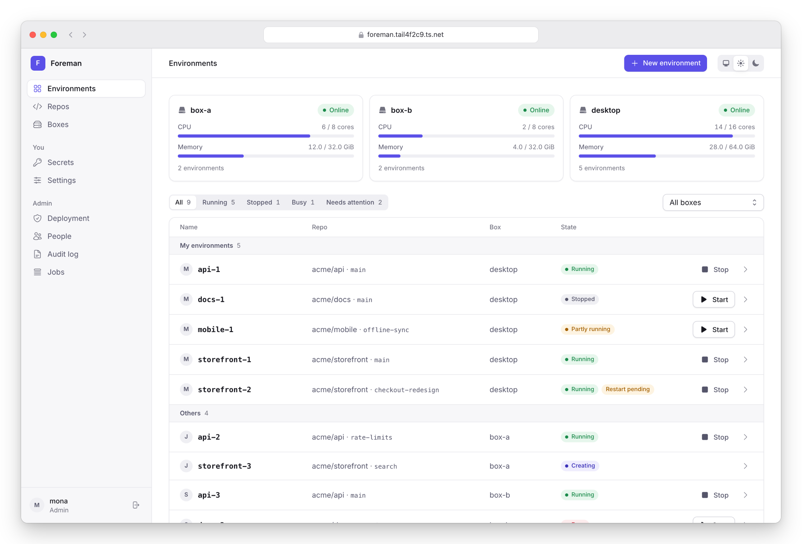
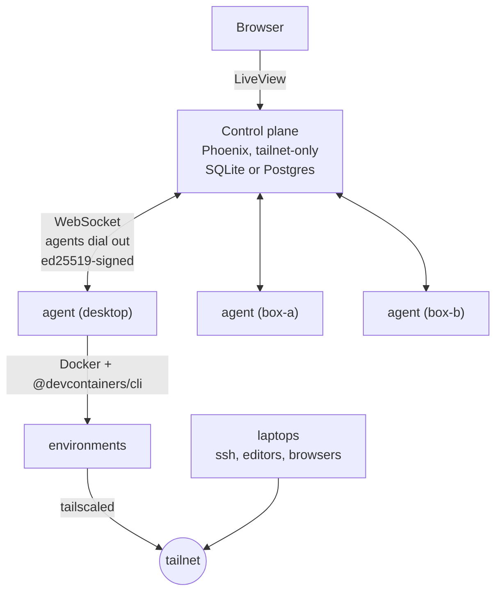
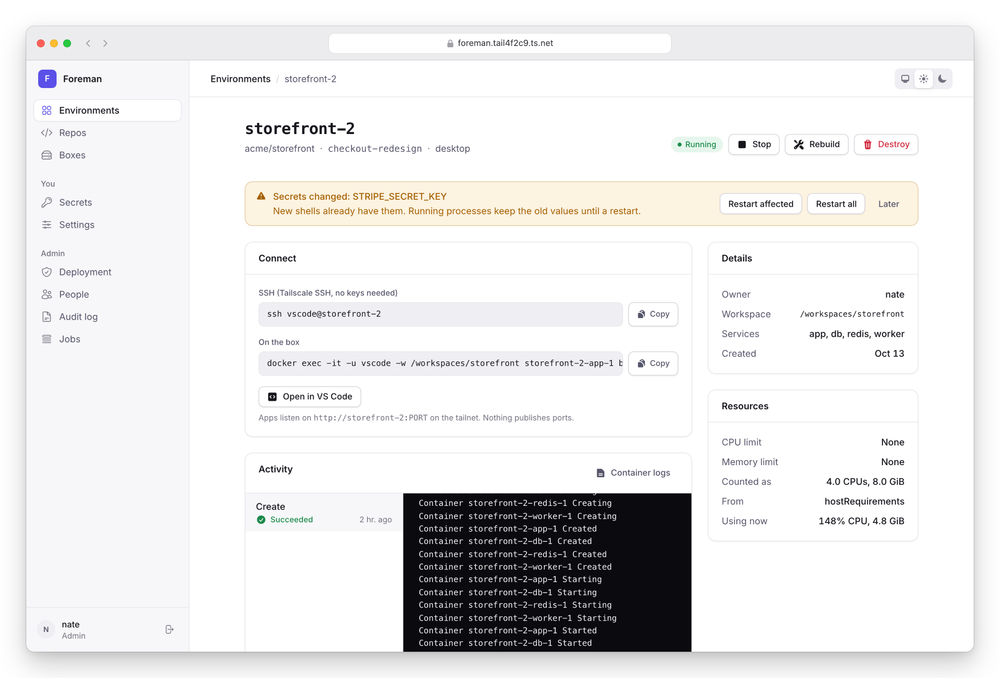
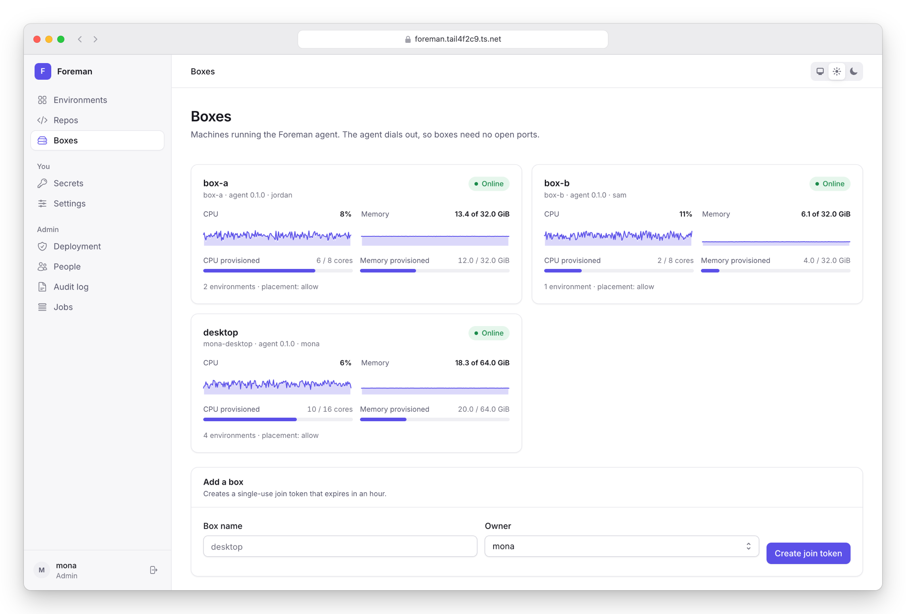
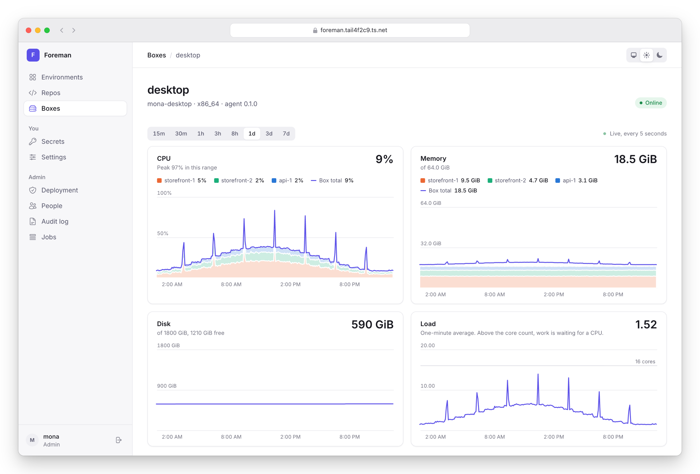
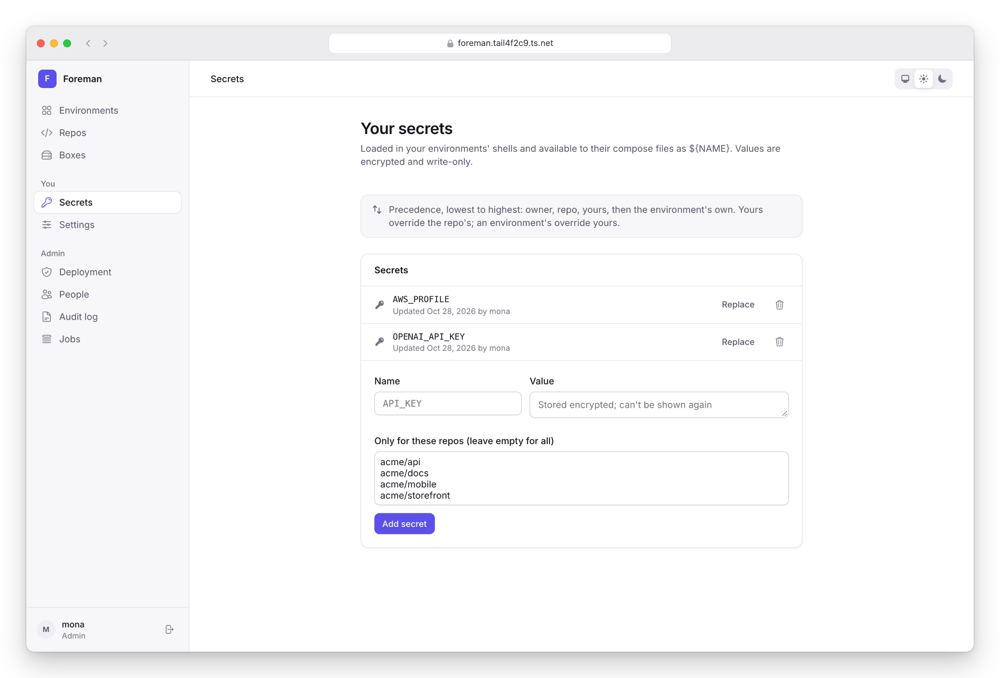

# Foreman

A self-hosted replacement for GitHub Codespaces. Pick a repo with a
compose-based devcontainer, pick one of your own machines, and Foreman
clones it, builds the devcontainer, delivers its secrets and joins it to
your tailnet. Run as many copies of a repo side by side as you like;
nothing publishes ports.

<picture>
  <source media="(prefers-color-scheme: dark)" srcset="docs/images/environments-dark.png">
  
</picture>



- **Control plane** (`apps/foreman`): Phoenix + LiveView. Owns users,
  repos, boxes, environments, secrets and the audit log.
- **Agent** (`apps/foreman_agent`): an Elixir release on each box. Dials
  out to the control plane, runs `git`, `docker compose` and the
  devcontainer CLI, and updates itself.
- **Protocol** (`apps/foreman_protocol`): the commands and events between
  them, validated by the same code on both sides.
- **Feature** (`features/src/foreman`): a devcontainer feature the agent
  adds to every environment: Tailscale (with Tailscale SSH), the secrets
  shell hook, git identity and a GitHub credential helper.

The design, and the decisions behind it, are in
[docs/architecture.md](docs/architecture.md). The security model is in
[docs/security.md](docs/security.md).

## What it does

- Environments from any repo the GitHub App can see that has a
  compose-based devcontainer. Named `<repo>-<n>` (personal) or
  `<repo>-<login>-<n>` (team), and that name is the compose project,
  the Tailscale hostname and `ssh <user>@<name>`.
- Secrets at four scopes (owner, repo, user, environment), encrypted at
  rest, write-only in the UI, delivered to a tmpfs on the box and loaded
  by login shells. Changing one updates new shells immediately and offers
  **Restart affected**, **Restart all** or **Later**.
- A GitHub token per environment, scoped to its repo by default (a repo
  can opt out to the user's own token), refreshed every few hours.
- Git identity and dotfiles per user, overridable per repo.
- Environments run unprivileged. Privileged containers (including
  docker-in-docker), host namespaces, the Docker socket and host mounts
  are refused, checked against features as well as the repo's own
  files. A box can open one up as an exception, and the control plane
  shows it with a red alert. Services go in the compose file as
  sidecars instead; see
  [docs/setup/repos.md](docs/setup/repos.md#docker-inside-an-environment).
- Capacity reporting per box: used and provisioned CPU and memory, with
  contention warnings. Boxes allow overcommit by default and can be set
  to warn or refuse.
- Boxes enroll with a one-time token, survive reboots (the control plane
  restores secrets and restarts environments), and update their agents
  from signed releases.

An environment right after one of its secrets changed. New shells
already have the new value; running services keep the old one until you
pick a restart.

<picture>
  <source media="(prefers-color-scheme: dark)" srcset="docs/images/environment-dark.png">
  
</picture>

Boxes, with live CPU and memory trends next to what's provisioned.

<picture>
  <source media="(prefers-color-scheme: dark)" srcset="docs/images/boxes-dark.png">
  
</picture>

A box over the last day: CPU and memory as the box total over each
environment's share, disk, and load against the core count. Ranges run
from 15 minutes to 7 days, and the charts update every 5 seconds.

<picture>
  <source media="(prefers-color-scheme: dark)" srcset="docs/images/box-dark.png">
  
</picture>

Your own secrets. Values are encrypted and can't be read back.

<picture>
  <source media="(prefers-color-scheme: dark)" srcset="docs/images/secrets-dark.png">
  
</picture>

The screenshots use made-up data; `e2e/demo.exs` and
`e2e/screenshots.mjs` regenerate them (see [e2e/README.md](e2e/README.md)).

## Running it

| | |
|---|---|
| Personal (a Linux desktop, SQLite) | [docs/setup/personal.md](docs/setup/personal.md) |
| Team (EC2 + Postgres/Neon, a box per developer) | [docs/setup/team.md](docs/setup/team.md) |
| The GitHub App | [docs/setup/github-app.md](docs/setup/github-app.md) |
| Tailscale | [docs/setup/tailscale.md](docs/setup/tailscale.md) |
| Private registry (GHCR) credentials | [docs/setup/ghcr-machine-user.md](docs/setup/ghcr-machine-user.md) |
| Moving a repo off Codespaces | [docs/setup/repos.md](docs/setup/repos.md) |

## Developing

Tool versions are in `mise.toml` (Erlang 29, Elixir 1.20, Node 22).

```sh
mise install

# Control plane (SQLite by default; FOREMAN_DB=postgres for Postgres)
cd apps/foreman
mix setup
mix phx.server          # http://localhost:4000, with a dev sign-in

# Agent, against a local control plane and Docker Desktop
cd apps/foreman_agent
FOREMAN_URL=http://localhost:4000 FOREMAN_JOIN_TOKEN=fj_... mix run --no-halt
```

Each app has `mix precommit` (format, credo, tests; sobelow too for the
control plane).

### Tests

| | |
|---|---|
| `cd apps/foreman_protocol && mix test` | Message contracts, signatures, redaction |
| `cd apps/foreman_agent && mix test` | Agent logic with fakes for Docker and the CLIs |
| `cd apps/foreman_agent && mix test --only docker` | The agent against real Docker and the devcontainer CLI: two copies side by side, secrets, restart affected, rebuild, destroy, a tampered compose file and a feature asking for privileged both refused |
| `cd apps/foreman && mix test` | Control plane (run with `FOREMAN_DB=postgres` too) |
| `devcontainer features test ... features` | The feature in a real devcontainer |
| `e2e/` | Full runs through the UI and on an emulated Linux box; see [e2e/README.md](e2e/README.md) |

## Layout

```
apps/
  foreman/            Phoenix control plane
  foreman_agent/      agent release
  foreman_protocol/   shared commands, events, auth and redaction
features/src/foreman  the devcontainer feature
docker/               release images (control plane, emulated box)
e2e/                  end-to-end runs
docs/                 architecture, security, setup
```
