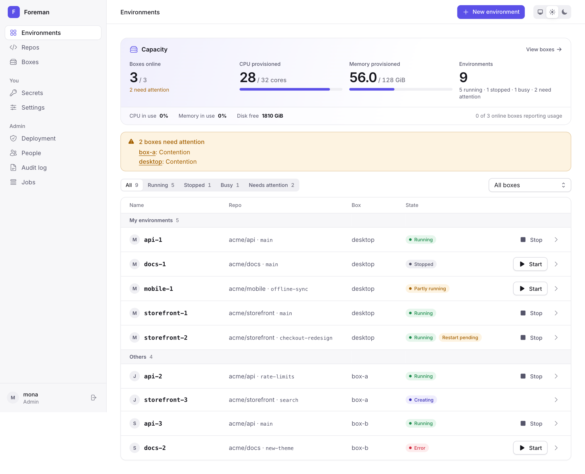
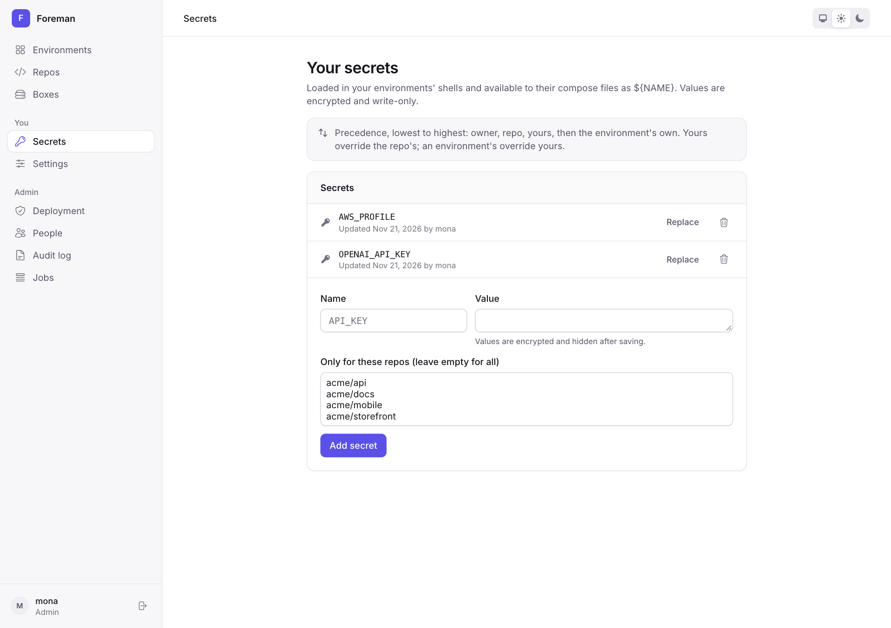

# Foreman

Foreman is a self-hosted stand-in for GitHub Codespaces. You point it at a
repo with a compose-based devcontainer and one of your own machines. It
starts a VM there for the environment, clones the repo into it, builds
the devcontainer, hands it its secrets and puts it on your tailnet. Run
as many copies of the same repo side by side as you like. None of them
publish a port.

<picture>
  <source media="(prefers-color-scheme: dark)" srcset="docs/images/environments-dark.png">
  
</picture>

## How it works

The control plane (`apps/foreman`) is a Phoenix app you reach only over
your tailnet. It's what you use in the browser, and it keeps track of
users, repos, boxes, environments, secrets and the audit log. It runs on
SQLite for one person or Postgres for a team.

A machine that hosts environments is a box, and it runs the agent
(`apps/foreman_agent`), an Elixir release. A box is an amd64 Linux
machine with KVM: Debian or Ubuntu running the install script, or
Flatcar Container Linux in a VM on a Linux machine (or Proxmox), set up
on its first boot from a config the control plane makes, and updating
its OS itself. Flatcar on bare metal works the same way but hasn't been
tested with environment VMs yet
([#179](https://github.com/ntodd/foreman/issues/179)). Mac boxes are
gone until environment VMs run on Apple's hypervisor
([#180](https://github.com/ntodd/foreman/issues/180)). The agent dials
out to the control plane over a WebSocket, so boxes need no open ports,
and every message is signed with ed25519. It updates itself when a new
release comes out.

Every environment runs in a [Cloud Hypervisor](https://github.com/cloud-hypervisor/cloud-hypervisor)
VM of its own, with its own kernel, Docker and Compose. The agent on the
box runs unprivileged. A small root helper gives each VM its network tap
and a systemd unit with CPU and memory limits, and the agent relays the
control plane's commands over vsock to the same agent release running
inside the VM, which brings the environment up with `git`,
`docker compose` and the devcontainer CLI. The box itself needs neither
Docker nor git.

On top of each repo's own config, Foreman adds a devcontainer feature
(`features/src/foreman`). It installs Tailscale with Tailscale SSH, the
shell hook that loads secrets, your git identity and a credential helper
for GitHub. Your laptop reaches an environment over the tailnet, by name,
with ssh, an editor or a browser.

The commands and events the two sides exchange live in
`apps/foreman_protocol`, so both ends validate messages with the same code.

[docs/architecture.md](docs/architecture.md) explains the design and why
it's built that way. [docs/security.md](docs/security.md) covers the
security model.

## What you get

Any repo the GitHub App can see that has a compose-based devcontainer can
become an environment. Environments are named `<repo>-<n>` on a personal
setup or `<repo>-<login>-<n>` on a team one. That one name is the compose
project, the Tailscale hostname and what you type after `ssh <user>@`.

Secrets come at four levels: owner, repo, user and environment. They're
encrypted at rest and can't be read back in the UI. They land on a tmpfs
in the environment's VM, and login shells load them from there. When one
changes, new shells see it right away and Foreman asks whether to
restart the affected services, restart everything, or leave it for
later. A secret you tried
out on one environment can move up to your own secrets for that repo, or,
for an admin, to the repo's, without anyone seeing the value.

Each environment gets its own GitHub token, scoped to its repo, and
Foreman refreshes it every few hours. A repo can opt to use the person's
own token instead. Git identity and dotfiles are set per person, with
per-repo overrides.

An environment's VM is the wall around it. Code in an environment (a
coding agent gone wrong, say) can be root there, run privileged
containers and docker-in-docker, and still not reach the box, other
environments or the tailnet as the box: the box's firewall lets a VM
reach the internet, and the box's LAN unless the box blocks it, and
nothing else. [docs/setup/repos.md](docs/setup/repos.md#docker-inside-an-environment)
covers Docker inside an environment.

A devcontainer feature can ship a connect hook (Orca's does). The
environment page then shows the owner a pairing code or QR code, once.
See [docs/setup/connect-hooks.md](docs/setup/connect-hooks.md).

Each VM has a size: the environment's or the repo's limits, or the box's
default of 4 CPUs and 8 GB. Boxes report used and provisioned CPU and
memory and warn about contention, with a threshold for each, so a box
can overcommit CPU a lot and memory a little. They allow placement past
it by default and can be set to warn or refuse instead. A box joins with a one-time token.
After a reboot the control plane puts its secrets back and restarts its
environments. Boxes
update their agents from signed releases, and a release is a single tag:
it builds the control plane images on GHCR with the matching agents
inside, and the boxes follow.

## A look around

An environment just after one of its secrets changed. New shells already
have the new value. Running services keep the old one until you pick a
restart.

<picture>
  <source media="(prefers-color-scheme: dark)" srcset="docs/images/environment-dark.png">
  
</picture>

The Boxes page puts live CPU and memory trends next to what's provisioned.

<picture>
  <source media="(prefers-color-scheme: dark)" srcset="docs/images/boxes-dark.png">
  
</picture>

A box over the last day. CPU and memory stack each environment's share
under the box total. Disk sits next to them, and load is drawn against the
core count. Ranges go from 15 minutes to 7 days, and the charts update
every 5 seconds.

<picture>
  <source media="(prefers-color-scheme: dark)" srcset="docs/images/box-dark.png">
  
</picture>

Your own secrets. Values are encrypted and can't be read back.

<picture>
  <source media="(prefers-color-scheme: dark)" srcset="docs/images/secrets-dark.png">
  
</picture>

The screenshots use made-up data. `e2e/demo.exs` and `e2e/screenshots.mjs`
regenerate them; see [e2e/README.md](e2e/README.md).

## Running it

| Setup | Guide |
|---|---|
| Personal (a Linux desktop, SQLite) | [docs/setup/personal.md](docs/setup/personal.md) |
| Team (EC2 + Postgres/Neon, a box per developer) | [docs/setup/team.md](docs/setup/team.md) |
| Flatcar boxes (a VM on Linux or Proxmox, or bare metal) | [docs/setup/flatcar.md](docs/setup/flatcar.md) |
| Upgrading, backups and rolling back (and moving to environment VMs) | [docs/setup/upgrading.md](docs/setup/upgrading.md) |
| The GitHub App | [docs/setup/github-app.md](docs/setup/github-app.md) |
| Tailscale | [docs/setup/tailscale.md](docs/setup/tailscale.md) |
| Private registry (GHCR) credentials | [docs/setup/ghcr-machine-user.md](docs/setup/ghcr-machine-user.md) |
| Moving a repo off Codespaces | [docs/setup/repos.md](docs/setup/repos.md) |
